<div align="center">

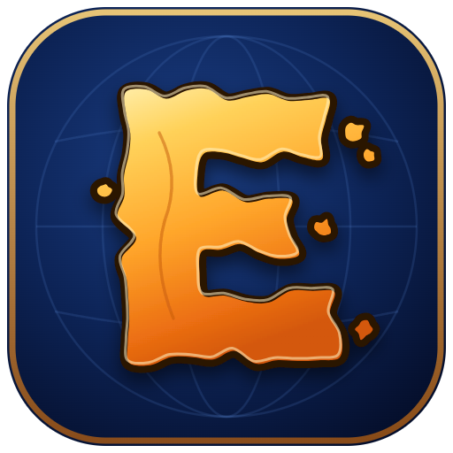

### Simulador do Mundo

**Escolha uma era, escolha uma nação e veja a história ser reescrita.**


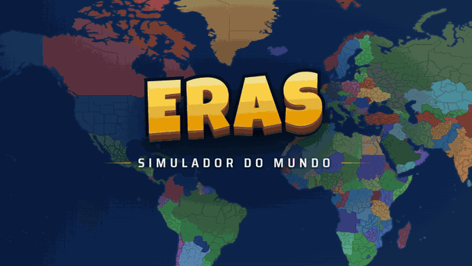

**[▶ Assista ao trailer completo, com som (MP4, 30 s)](docs/trailer.mp4)**

</div>

---

## O que é

**ERAS** é um simulador geopolítico em que nações disputam território num mapa-múndi interativo. Cada partida começa em um momento real da história e segue sozinha, mês a mês: guerras, alianças, eleições, golpes, epidemias, avanços tecnológicos, Copas do Mundo e Olimpíadas. **Nada é roteirizado.** A mesma Segunda Guerra pode terminar com a China dominando a Ásia ou com um império inesperado no topo.

Você pode **assistir** o mundo evoluir no **Modo Simulação** ou **jogar** com uma nação: administrar cidades e províncias, investir na economia, recrutar exércitos, negociar tratados e declarar guerras.

O motor foi escrito do zero, sem frameworks: cerca de 5 mil linhas de JavaScript, com ferramentas próprias para gerar os mapas e testar o balanceamento.

## Mais de 20 cenários

| Atuais | Históricos | Continentais e especiais |
|---|---|---|
| Mundo Atual: 250 nações e seus chefes de Estado | Império Romano (ano 117) | Potências Continentais |
| Estados do Brasil: as 27 unidades federativas | Era das Navegações (1500) | Europa, Ásia, África, Américas e Oceania |
| Cidades-Estado: as 200 maiores cidades | Guerras Napoleônicas (1805) | Mundo em 2150: blocos supranacionais |
| | Brasil Império (1822) | Reino IOS e IOS no Mundo: reinos de uma comunidade de amigos |
| | Primeira e Segunda Guerra Mundial | |
| | Guerra Fria (1962) | |
| | Regiões do Brasil | |

## Imagens

<table>
<tr>
<td width="50%">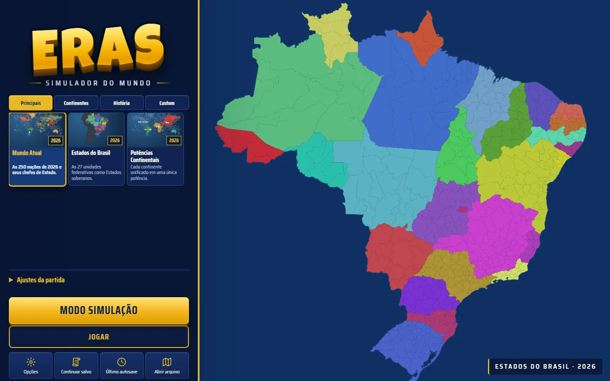<br><sub><b>Menu:</b> cenários atuais, por continente, históricos e personalizados.</sub></td>
<td width="50%">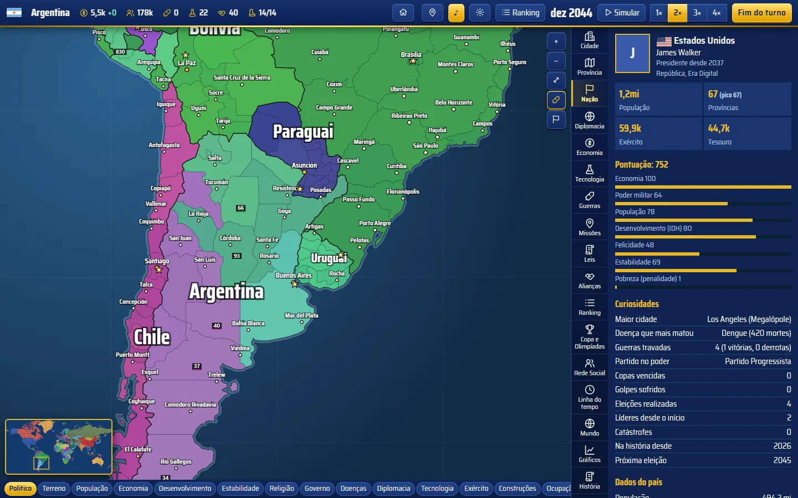<br><sub><b>Mapa detalhado:</b> províncias, cidades e capitais, com zoom e arrasto.</sub></td>
</tr>
<tr>
<td>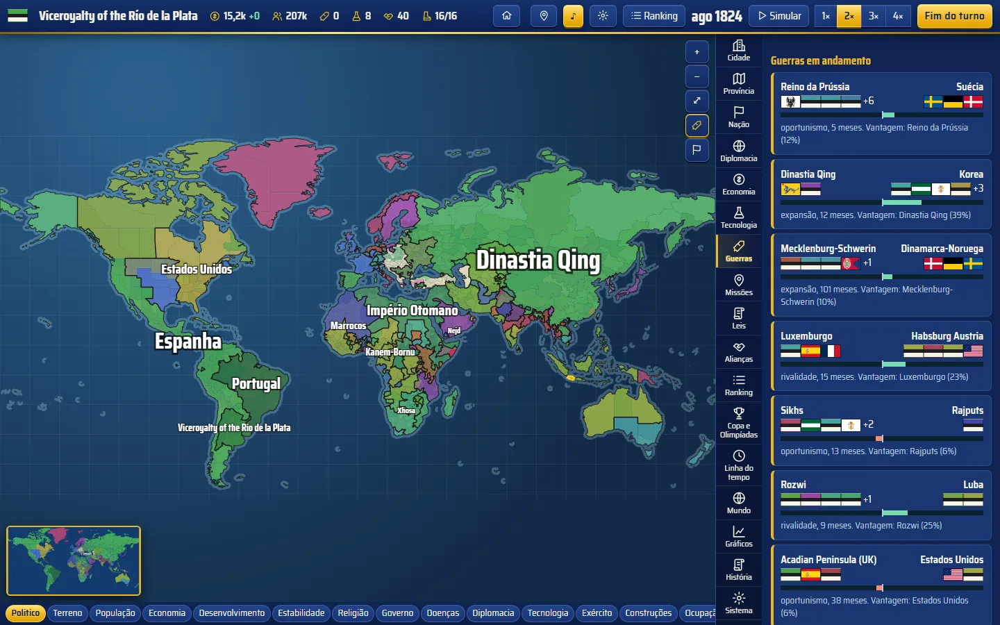<br><sub><b>Guerras Napoleônicas:</b> cada guerra mostra os lados, a duração e quem está vencendo.</sub></td>
<td>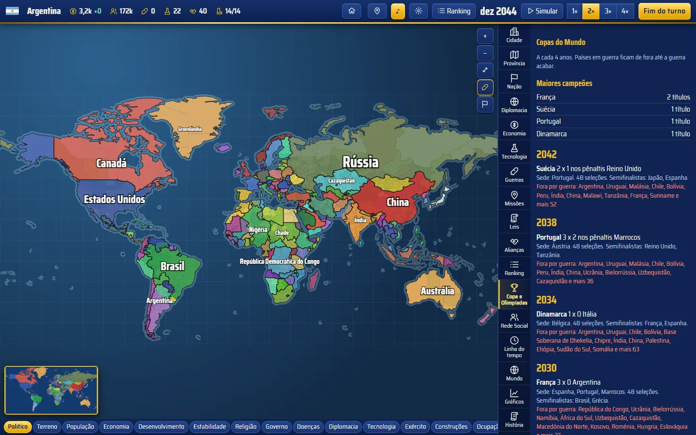<br><sub><b>Copas do Mundo:</b> a cada 4 anos, com pênaltis, e países em guerra ficam de fora.</sub></td>
</tr>
<tr>
<td>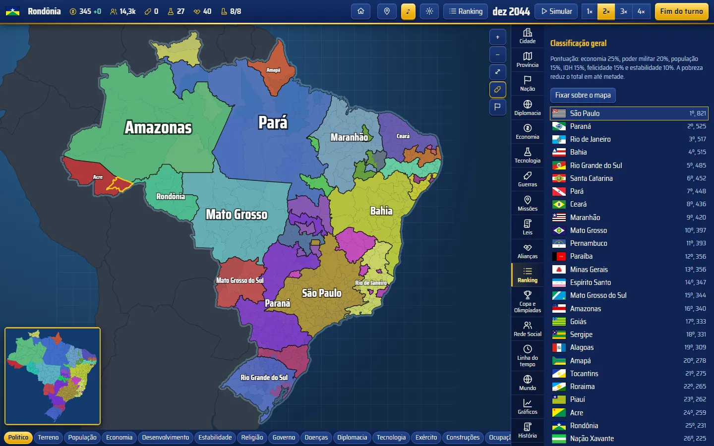<br><sub><b>Estados do Brasil:</b> os 27 estados como nações soberanas, com ranking e bandeiras.</sub></td>
<td>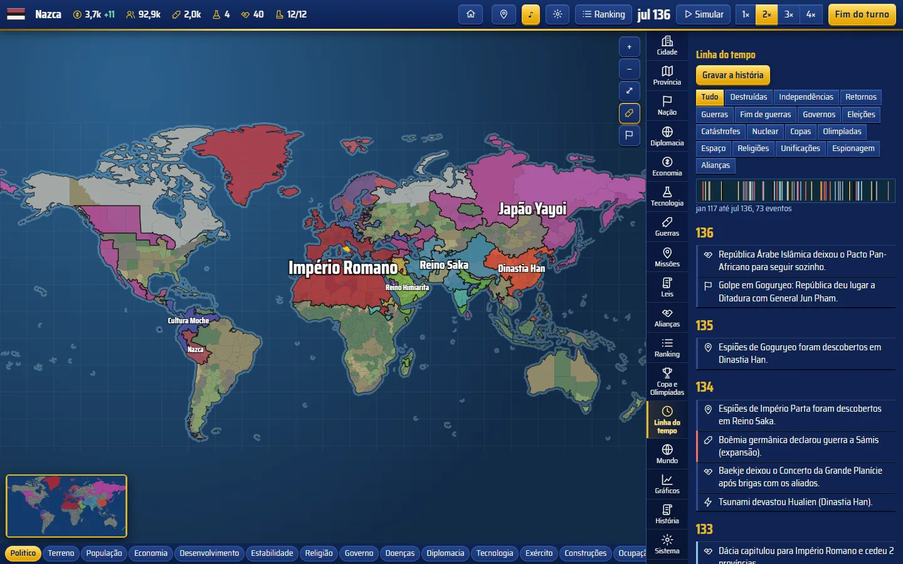<br><sub><b>Império Romano:</b> a linha do tempo registra golpes, espionagem, guerras e catástrofes.</sub></td>
</tr>
<tr>
<td>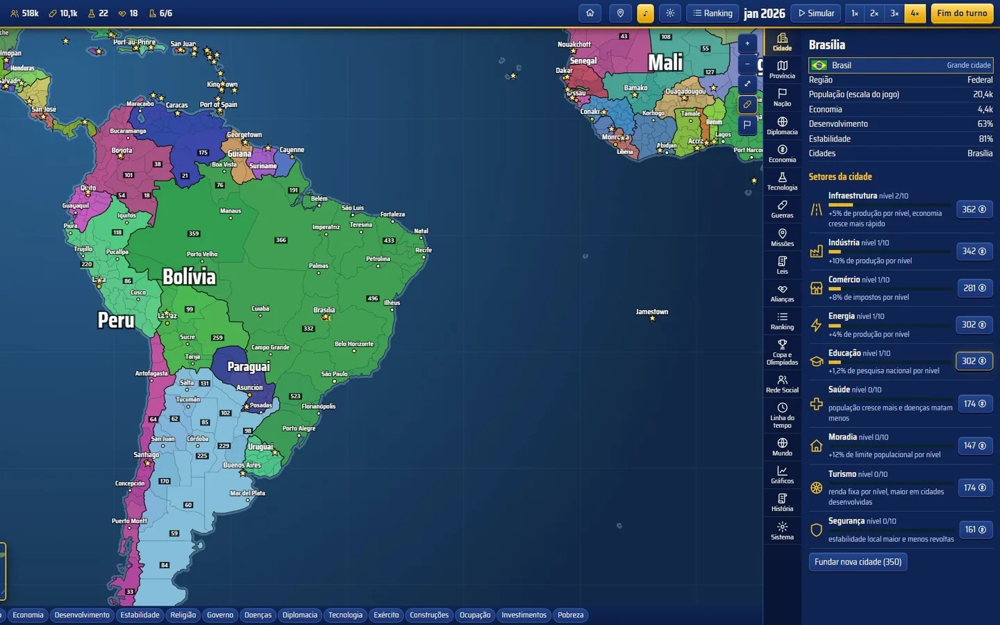<br><sub><b>Modo Jogar:</b> cada cidade tem setores (infraestrutura, indústria, comércio…) que sobem de nível com o ouro do tesouro.</sub></td>
<td>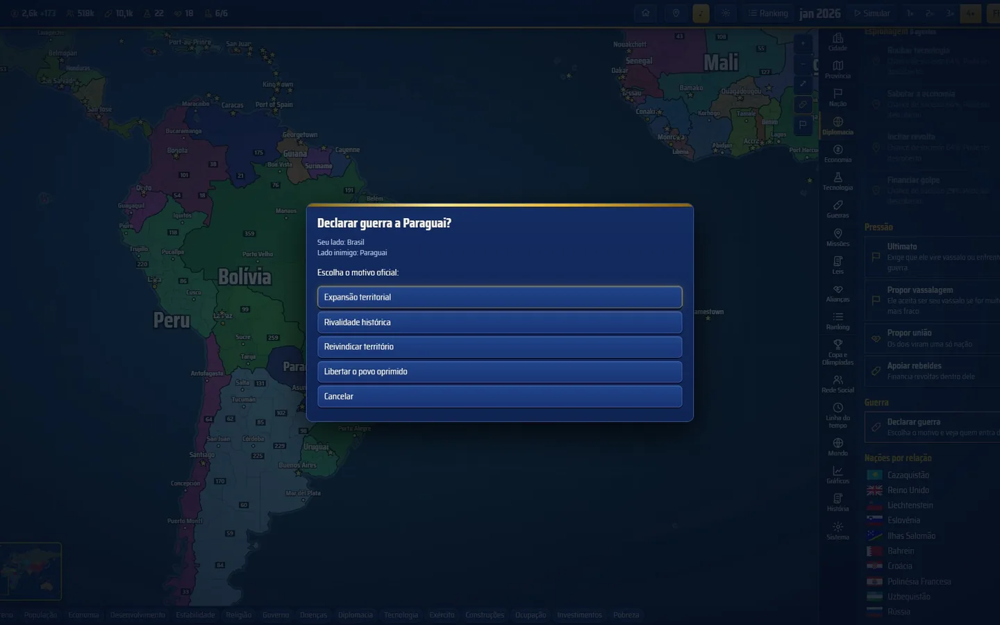<br><sub><b>Diplomacia e guerra:</b> o jogo mostra quem entra de cada lado e pede o motivo oficial da guerra.</sub></td>
</tr>
<tr>
<td colspan="2">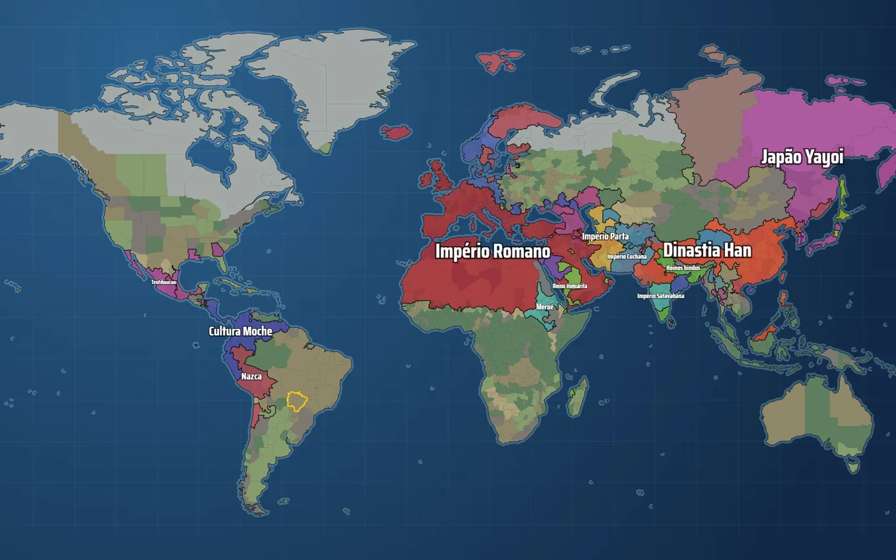<br><sub><b>Modo Simulação:</b> o mundo evolui sozinho, mês a mês, e cada partida conta uma história diferente.</sub></td>
</tr>
</table>

## Destaques técnicos

- **Motor de simulação próprio** (`engine.js`): economia, população e tecnologia calibradas com taxas históricas reais de cada época.
- **IA de guerra e diplomacia:** orçamento, rivalidades, cansaço de guerra, cessar-fogo e tratados de paz. Alianças se formam e se dissolvem.
- **Mapas gerados por scripts** (`tools/build-map.mjs`, `tools/build-nations.mjs`) a partir de dados geográficos abertos.
- **Ilha procedural:** o cenário Reino IOS gera uma ilha vetorial a partir de uma semente, com litoral idêntico para cada reino.
- **Histórico permanente:** campeões, líderes e eventos nunca são apagados. As séries antigas perdem resolução em vez de serem cortadas.
- **Balanceamento por simulação em massa:** Monte Carlo e partidas longas sem interface (`tools/monte-carlo.cjs`, `tools/longrun.cjs`).
- **Desempenho:** bandeiras convertidas em bitmap uma única vez e contornos dos países em cache. Há um modo de benchmark embutido (`index.html?bench=<cenário>`).

## Como jogar

Não precisa instalar nada:

1. Baixe o repositório (**Code → Download ZIP**) e extraia.
2. Abra o arquivo `index.html` no navegador.
3. Escolha um cenário e clique em **Modo Simulação** para assistir, ou em **Jogar** para comandar uma nação.

> Dica: o jogo salva automaticamente. Use **Continuar salvo** no menu para retomar.

## Testes

```bash
node tools/test-all.cjs           # motor + interface (usa o Microsoft Edge sem janela)
node tools/test-all.cjs --rapido  # só o motor, sem navegador
```

Cada cenário é criado e simulado por 10 anos. Os testes procuram números inválidos, conferem salvar/carregar e rodam o autoteste da interface.

## Estrutura

```
index.html      interface e menu
engine.js       motor de simulação
ui.js           mapa, painéis e controles
roster.js       reinos do cenário personalizado
data/           mapas, nações, líderes, cidades e eventos (gerados pelos scripts)
assets/         fontes, logotipo, bandeiras, miniaturas dos cenários e fotos de líderes
tools/          geração de mapas e dados, testes, balanceamento e empacotamento
```

## Créditos e licenças

- **Código:** [licença MIT](LICENSE) © 2026 Guilherme Matzembacker.
- **Mapas:** [Natural Earth](https://www.naturalearthdata.com/) (domínio público), malhas do [IBGE](https://www.ibge.gov.br/) e o projeto [historical-basemaps](https://github.com/aourednik/historical-basemaps). Os dados derivados seguem as licenças das fontes originais.
- **Líderes e bandeiras históricas:** [Wikidata](https://www.wikidata.org/) e [Wikimedia Commons](https://commons.wikimedia.org/). Cada foto mantém a licença do seu autor; a lista de arquivos e origens está em [`assets/leaders/CREDITOS.txt`](assets/leaders/CREDITOS.txt).
- **Fontes tipográficas:** Luckiest Guy e Saira, sob a SIL Open Font License.

ERAS é um projeto independente, sem vínculo com outros jogos de estratégia.
